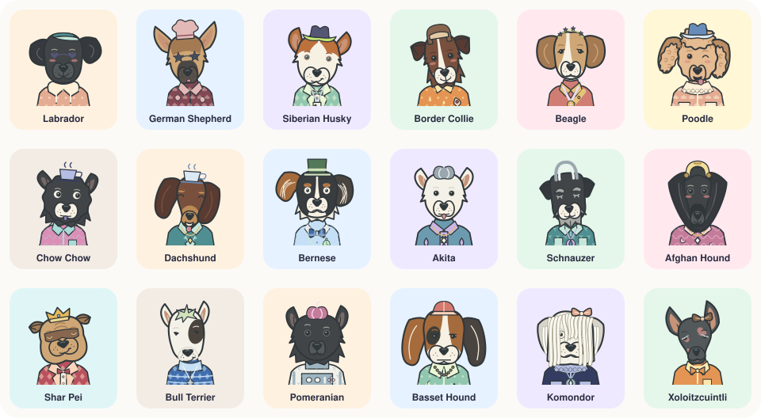
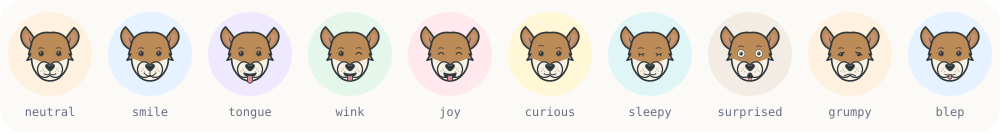
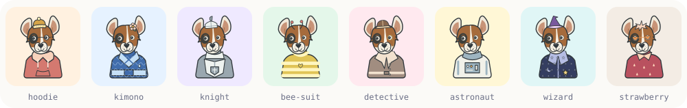
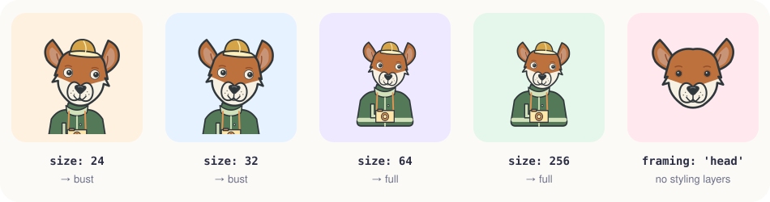

<div align="center">


# 🐶 Doggy Avatar Generator

**Deterministic, dependency-free SVG dog avatars for JavaScript & TypeScript.**

One seed in, one very good dog out: 120 breeds, 76,800 collectible looks, and zero network calls.

[](https://github.com/CartemisAI/doggy-avatar-generator/releases)
[](https://github.com/CartemisAI/doggy-avatar-generator/actions/workflows/ci.yml)
[](LICENSE)
[](package.json)
[](src/index.d.ts)
[](package.json)

[Quick start](#-quick-start) · [Gallery](#-gallery) · [Size-aware framing](#-size-aware-composition) · [API](#-api-at-a-glance) · [Docs](docs/API.md) · [Releases](https://github.com/CartemisAI/doggy-avatar-generator/releases)

</div>

---

## ✨ Highlights

- 🎲 **Deterministic.** The same package version, seed and options always produce the exact same SVG string.
- 🪶 **Zero runtime dependencies.** No AI models, no DOM, no canvas, no filesystem, no network, no credentials.
- 🐕 **120 stylized breeds** across 12 head-shape and coat families, from Labradors to Xoloitzcuintli.
- 👕 **A full wardrobe.** 48 outfits, 40 headwear choices, 30 accessories, 30 colorways per layer and 12 fabric patterns.
- 🔍 **Size-aware composition.** Tiny 24/32px avatars automatically switch to a big-head bust so they stay readable.
- 🎴 **A fixed 76,800-entry collection** with stable IDs (`dog-00001` to `dog-76800`) for pick-your-dog flows.
- 🟦 **Typed, synchronous ESM API** with literal-union types for every breed and styling option.
- 🌍 **Runs anywhere SVG does:** Node.js 20+, browsers, workers, SSR, static asset pipelines.

## 📸 Gallery

<p align="center">
  
</p>

<p align="center"><sub><b>18 of the 120 breeds.</b> Every avatar above is real output from <code>createAvatar()</code>.</sub></p>

<p align="center">
  
</p>

<p align="center"><sub><b>20 expressions</b>, from <code>smile</code> to <code>side-eye</code> to <code>blep</code>.</sub></p>

<p align="center">
  
</p>

<p align="center"><sub><b>Same dog, different fit.</b> Changing clothes never resamples the dog's anatomy.</sub></p>

## 🚀 Quick start

### Install

The package is distributed through [GitHub Releases](https://github.com/CartemisAI/doggy-avatar-generator/releases):

```sh
npm install https://github.com/CartemisAI/doggy-avatar-generator/releases/download/v1.0.0/doggy-avatar-generator-1.0.0.tgz
```

Or install straight from the version tag:

```sh
npm install github:CartemisAI/doggy-avatar-generator#v1.0.0
```

### Generate your first dog

```ts
import { createAvatar, toDataUri } from 'doggy-avatar-generator';

const svg = createAvatar('account-42', {
  breed: 'samoyed',
  size: 32,
  outfit: 'hoodie',
  headwear: 'beanie',
  garmentColor: 'sky',
  headwearColor: 'rose',
});

const src = toDataUri(svg);
// 
```

Use any stable string or number as the seed (a user ID, an email hash, a username). Save the seed and the options you chose, and you can reproduce the exact same dog forever.

<details>
<summary><b>Example: a React avatar component</b></summary>

<br>

```tsx
import { useMemo } from 'react';
import { createAvatar, toDataUri, type AvatarOptions } from 'doggy-avatar-generator';

export function DogAvatar({ seed, size = 32, ...options }: { seed: string; size?: number } & AvatarOptions) {
  const src = useMemo(
    () => toDataUri(createAvatar(seed, { ...options, size })),
    // Regenerate when any rendering input changes.
    [seed, size, JSON.stringify(options)],
  );
  return ;
}
```

Pass the **CSS display size** as `size`, even on high-density screens: the output is vector art, and the size drives composition (see below). Set alternative text that suits your UI.

</details>

## 📏 Size-aware composition

<p align="center">
  
</p>

Small avatars live or die by their face, so the renderer picks a composition from the size you pass:

| Logical display size | Default composition |
| --- | --- |
| Exactly **24px** or **32px** | `bust`: large head with a little shoulder and neckline |
| Every other size | `full`: normal half-body portrait |

The same seed and styling keep the same dog across sizes. Resizing an existing SVG with CSS does **not** rerun the rule, so regenerate when the display size changes.

Override it any time with `framing: 'bust' | 'full' | 'head'` (default `'auto'`). Head-only framing leaves out clothing, headwear and accessories. The artwork does not include hands or front paws.

## 🎴 The fixed collection

Want users to *pick* a dog instead of being assigned one? Use the built-in collection:

```ts
import {
  createCollectionAvatar,
  getCollectionEntry,
  COLLECTION_COUNT,
} from 'doggy-avatar-generator';

const svg = createCollectionAvatar(981, { size: 24 });
const entry = getCollectionEntry(981); // entry.id === "dog-00982"
console.log(COLLECTION_COUNT);         // 76800
```

**120 breeds × 32 individuals × 20 looks = 76,800 entries.** Indices run from `0` to `76799`; display IDs run from `dog-00001` to `dog-76800`. Persist the **collection index** to reproduce a look; the entry's base seed alone does not identify it.

> [!NOTE]
> Background colors do not count toward the collection size. Different indices are not a guarantee that every portrait is perceptually distinct at small sizes, and some breed recipes share underlying structures.

### What's in the box

| Layer | Options | Examples |
| --- | ---: | --- |
| 🐕 Breeds | 120 | `labrador`, `shiba`, `corgi`, `komondor`, `xolo` |
| 😊 Expressions | 20 | `smile`, `wink`, `sleepy`, `side-eye`, `blep` |
| 🎨 Coat palettes | 26 | `chestnut`, `biscuit`, `silver`, `tri`, `apricot` |
| 🐾 Coat-pattern overrides | 14 | `blaze`, `spots`, `merle`, `brindle`, `urajiro` |
| 🧍 Poses | 12 | `upright`, `tilt-left`, `proud`, `cozy`, `stretch` |
| 👂 Ear states | 5 | `natural`, `alert`, `relaxed`, `left-perked` |
| 👕 Outfits | 48 | `hoodie`, `kimono`, `astronaut`, `bee-suit`, `jellyfish` |
| 🎩 Headwear | 40 | `beanie`, `crown`, `chef-hat`, `saturn`, `croissant` |
| 🕶️ Accessories | 30 | `sunglasses`, `monocle`, `headphones`, `fairy-wings` |
| 🌈 Colorways per layer | 30 | `lagoon`, `honey`, `midnight`, `aurora`, `neon` |
| 🧵 Fabric patterns | 12 | `stripes`, `polka`, `argyle`, `stars`, `clouds` |

Headwear and accessory counts include their `none` option. Every identifier is exported at runtime through `STYLE_OPTIONS` and `BREED_CATALOG`, and as TypeScript literal unions.

## 🧩 API at a glance

```ts
createAvatar(seed: string | number, options?: AvatarOptions): string
createCollectionAvatar(index: number, options?: CollectionAvatarOptions): string
getCollectionEntry(index: number): CollectionEntry
resolveFraming(size?: number, framing?: Framing): 'bust' | 'full' | 'head'
toDataUri(svg: string): string
```

Also exported: `VERSION`, `COLLECTION_COUNT`, `BREED_CATALOG` and `STYLE_OPTIONS`. Invalid inputs throw explicit `RangeError` / `TypeError`s.

| 📚 Guide | What's inside |
| --- | --- |
| [API reference](docs/API.md) | Parameters, return values, validation rules and catalogs |
| [Usage & integration](docs/INTEGRATION.md) | Persistence, rendering, caching and batch generation |
| [Development](docs/DEVELOPMENT.md) | Building, testing, packaging and repository layout |

## 🌐 Runtime support

| Environment | Notes |
| --- | --- |
| **Node.js 20+** | ESM only. Import from `doggy-avatar-generator`, or `./src/index.mjs` from source. |
| **Browsers** | Native ESM and `TextEncoder`. Each release ships a self-contained `doggy-avatar-generator.mjs` plus matching type declarations; serve them from your own static assets. |
| **Servers, workers & SSR** | Same API, no DOM needed. Pass a stable `prefix` per instance when inlining several SVGs in one document. |

Everything is programmatic: there is no CLI and no hosted service.

## 🔁 Determinism & versioning

- **Package version** `1.0.0` · **artwork recipe** `dog-studio-3` (exported as `VERSION`).
- Same package version + seed + options → **byte-identical SVG**.
- Seeds are hashed as UTF-8 with explicit 32-bit integer math; styling streams are separate from anatomy, so changing an outfit never changes the dog.
- Collection samples are computed lazily and cached per breed.

> [!TIP]
> Store the package version next to each avatar spec when long-term reproducibility matters. The library does not load older rendering versions automatically, and SVG rasterization can differ between browsers and operating systems, so identical SVG source does not imply pixel-identical screenshots.

## 🛠️ Development

```sh
git clone https://github.com/CartemisAI/doggy-avatar-generator.git
cd doggy-avatar-generator
npm ci --ignore-scripts
npm run build   # standalone module + regenerated type declarations
npm test        # API tests + TypeScript declaration checks
```

The README images are generated by the library itself. Regenerate them with `node scripts/readme-assets.mjs`.

Bug reports and pull requests are welcome! Please [open an issue](https://github.com/CartemisAI/doggy-avatar-generator/issues) to discuss larger changes first. See [docs/DEVELOPMENT.md](docs/DEVELOPMENT.md) for the release process.

## 🙏 Acknowledgments

Doggy Avatar Generator stands on the shoulders of two wonderful MIT-licensed projects:

- [**Animatar**](https://github.com/luizvbo/animatar) by Luiz Otavio Vilas Boas Oliveira
- [**Animal Avatar Generator**](https://github.com/roma-lukashik/animal-avatar-generator) by Roman Lukashik

It extends them with deterministic dog-breed recipes, configurable expressions and outfits, size-aware composition and a standalone JavaScript/TypeScript API. Their original copyright and license notices are preserved in [`LICENSES/`](LICENSES) and included in distribution archives.

## 📄 License

Released under the [Apache License 2.0](LICENSE). See also [NOTICE](NOTICE).
Upstream MIT notices are retained in [Animatar-MIT.txt](LICENSES/Animatar-MIT.txt) and [Animal-Avatar-Generator-MIT.txt](LICENSES/Animal-Avatar-Generator-MIT.txt). The package runs independently of the original Rust workspace and includes no model assets.

<div align="center">

<br>

<sub>Made with 🦴 by <a href="https://github.com/CartemisAI">Cartemis AI</a> · If this made you smile, consider giving it a ⭐</sub>

</div>
