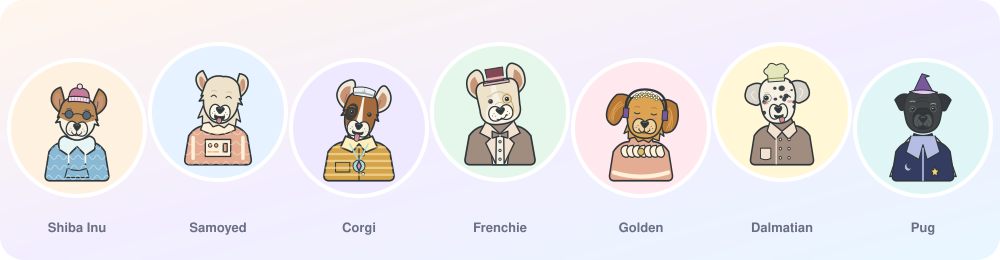

<div align="center">

# Doggy Avatar Generator

Deterministic SVG dog avatars for JavaScript and TypeScript.

[](https://github.com/CartemisAI/doggy-avatar-generator/actions/workflows/ci.yml)
[](https://github.com/CartemisAI/doggy-avatar-generator/releases)
[](LICENSE)
[](package.json)



</div>

## Features

- The same seed and options always produce the same SVG.
- 120 breeds with configurable expression, coat, outfit, headwear, accessories and colors.
- A fixed collection of 76,800 avatars with stable IDs.
- Large-head framing at 24 and 32 px, half-body framing at other sizes.
- Typed ESM API with no runtime dependencies. Runs in Node.js 20+ and modern browsers.

## Install

```sh
npm install github:CartemisAI/doggy-avatar-generator#v1.0.0
```

Package archives and a standalone browser module are on the [Releases](https://github.com/CartemisAI/doggy-avatar-generator/releases) page.

## Usage

```ts
import { createAvatar, createCollectionAvatar, toDataUri } from 'doggy-avatar-generator';

const svg = createAvatar('user-42', { breed: 'samoyed', size: 32, outfit: 'hoodie' });
const src = toDataUri(svg);

const fromCollection = createCollectionAvatar(981, { size: 128 });
```

Pass the size the avatar is displayed at, since it selects the framing.

## Documentation

- [API reference](docs/API.md)
- [Integration](docs/INTEGRATION.md)
- [Development](docs/DEVELOPMENT.md)

## License

[Apache-2.0](LICENSE). Adapted from [Animatar](https://github.com/luizvbo/animatar) and [Animal Avatar Generator](https://github.com/roma-lukashik/animal-avatar-generator) (MIT). See [NOTICE](NOTICE).

---

<p align="center">Built by <a href="https://cartemis-ai.com/">Cartemis AI</a></p>
